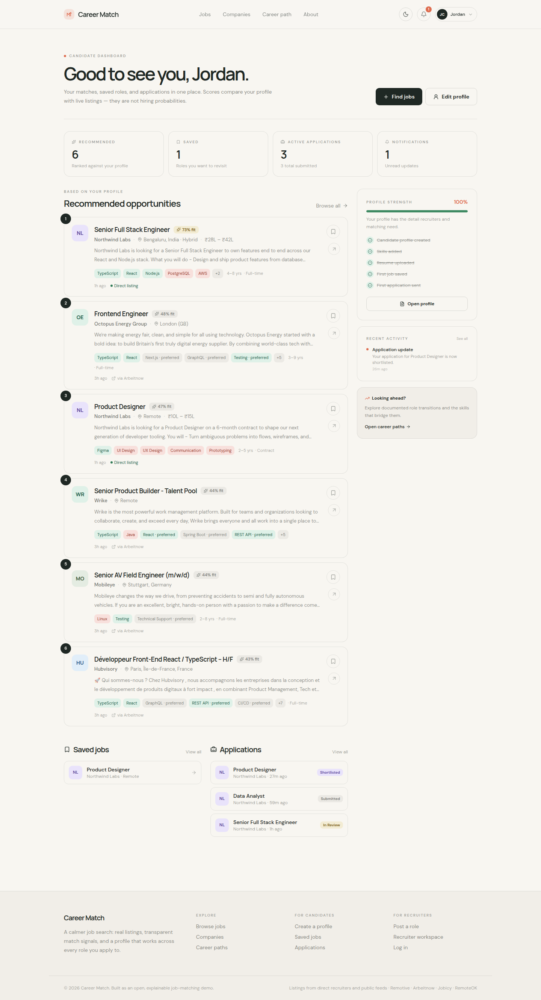
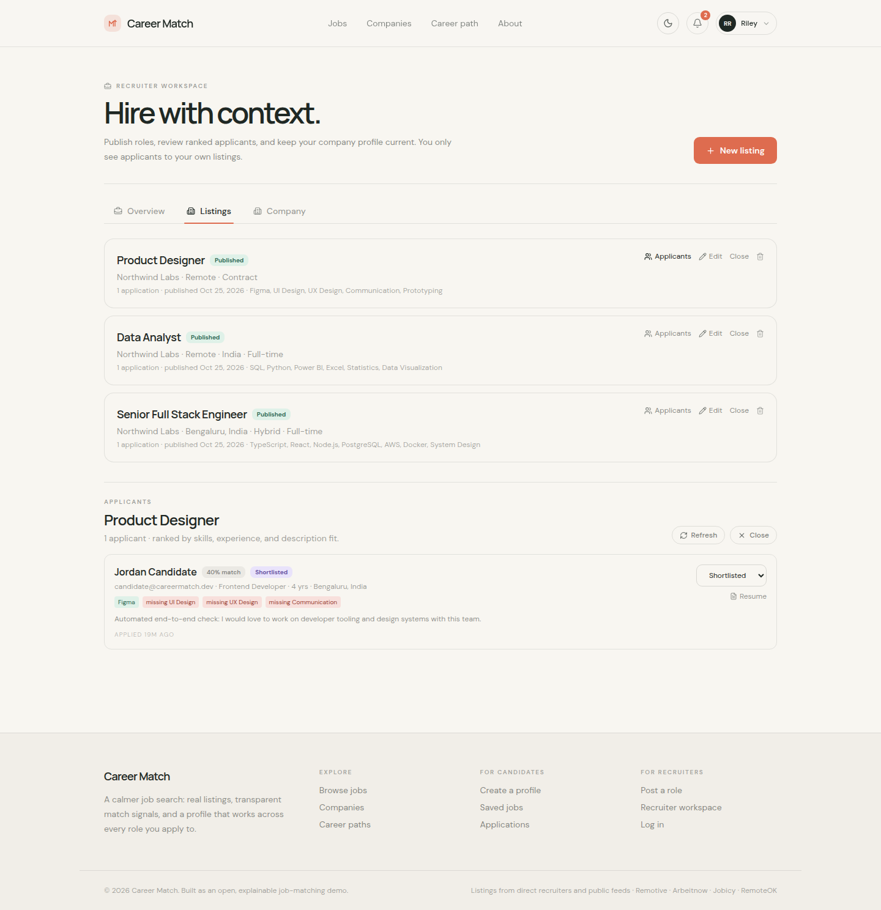
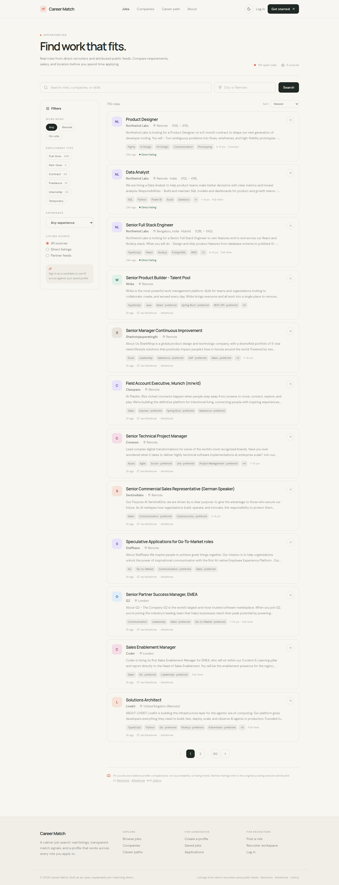
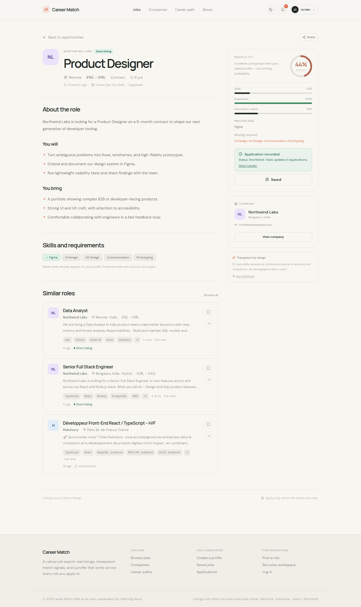

# Career Match

> **Find work that fits — not just work that exists.**

Career Match is an explainable job-discovery platform for candidates, recruiters, and admins. It combines real public listings, local resume parsing, transparent fit scores, and practical career-path suggestions in one polished workspace.



## Why Career Match?

Most job boards optimize for more applications. Career Match is built around **better decisions**:

- **Explainable recommendations** show matched skills, missing skills, experience fit, preferences, and the score behind every suggestion.
- **Real opportunities** come from public feeds and recruiter-created listings, with source attribution and links back to the original post.
- **Privacy-friendly parsing** extracts useful resume data locally in Node. An optional ML service can enhance extraction, but the core product does not depend on paid AI APIs.
- **Three focused workspaces** give candidates, recruiters, and admins the tools they actually need.

## Product tour

| Candidate workspace | Recruiter workspace |
| --- | --- |
|  |  |

| Search real jobs | Understand the match |
| --- | --- |
|  |  |

### Candidate workspace

- Build a profile and upload PDF/DOCX resumes.
- Discover ranked jobs with a visible match breakdown.
- Save jobs and track applications from saved to withdrawn.
- Review notifications, career paths, and profile gaps.

### Recruiter workspace

- Create, edit, publish, close, and delete listings.
- Manage company details and applicants.
- Download applicant resumes and update pipeline stages.
- Rank candidates with the same transparent matching signals.

### Admin workspace

- Monitor marketplace and account counters.
- Moderate listings and manage account roles.
- Disable accounts, review audit logs, and refresh public feeds.

## Built with

| Layer | Technology |
| --- | --- |
| Frontend | React 18, TypeScript, Vite 8, React Router, Tailwind CSS 4, Radix UI |
| API | Fastify 5, Zod, Swagger/OpenAPI |
| Data | PostgreSQL, Prisma 6 |
| Authentication | Short-lived JWT access cookie + rotating opaque refresh cookie |
| Resume parsing | `unpdf` and `mammoth`, with an optional Python enhancement service |
| Matching | Skills, experience, preferences, and in-process TF-IDF cosine similarity |
| Testing | Vitest |
| Deployment | Vercel-compatible SPA + Fastify serverless adapter |

## Quick start

### Requirements

- Node.js 20+
- pnpm 10+
- PostgreSQL (Neon, Supabase, or a local instance)

### Run locally

```bash
git clone <your-repository-url>
cd careerMatch_Project
pnpm install
cp .env.example .env
```

Set `DATABASE_URL` in `.env`, then apply the schema and start the app:

```bash
pnpm db:migrate
pnpm db:generate
pnpm dev
```

Open [http://localhost:8080](http://localhost:8080).

### Useful commands

```bash
pnpm dev            # Start the Vite + Fastify development app
pnpm build          # Generate Prisma, typecheck, and build the SPA
pnpm test           # Run the Vitest suite
pnpm typecheck      # Run TypeScript checks
pnpm start          # Start the API in production-like mode
pnpm jobs:sync      # Refresh all enabled public job feeds
pnpm demo:seed      # Add local demo accounts and sample listings
```

## Demo accounts

Run `pnpm demo:seed` to create local evaluation data:

| Role | Email | Password |
| --- | --- | --- |
| Admin | `admin@careermatch.dev` | `AdminPass12345` |
| Recruiter | `recruiter@careermatch.dev` | `RecruiterPass123` |
| Candidate | `candidate@careermatch.dev` | `CandidatePass123` |

These credentials are for local development only. Change or remove them before any public deployment.

## Job feeds

Keyless feeds work out of the box:

- [Remotive](https://remotive.com)
- [Jobicy](https://jobicy.com)
- [RemoteOK](https://remoteok.com)
- [Arbeitnow](https://www.arbeitnow.com)

For India-focused listings, optionally configure:

| Variables | Provider |
| --- | --- |
| `ADZUNA_APP_ID`, `ADZUNA_APP_KEY` | [Adzuna](https://developer.adzuna.com) |
| `JOOBLE_API_KEY` | [Jooble](https://jooble.org/api/about) |

Useful controls include `JOB_IMPORT_COUNTRY`, `JOB_IMPORT_QUERY`, `JOB_IMPORT_LOCATION`, `ADZUNA_PAGES`, `JOB_IMPORT_DISABLED`, and `JOB_SYNC_INTERVAL_HOURS`.

## Optional integrations

| Integration | Environment variables | Purpose |
| --- | --- | --- |
| Google sign-in | `GOOGLE_CLIENT_ID`, `VITE_GOOGLE_CLIENT_ID` | Google Identity Services login |
| Email | `BREVO_API_KEY` or `RESEND_API_KEY`, `EMAIL_FROM` | Verification and password-reset mail |
| ML service | `ML_SERVICE_URL`, `ML_SERVICE_API_KEY` | Enhanced extraction and embeddings |
| S3-compatible storage | `RESUME_STORAGE=s3` plus `RESUME_S3_*` / AWS variables | Scalable resume storage |
| Admin bootstrap | `ADMIN_BOOTSTRAP_SECRET` | One-time admin promotion |

The core product needs no external API key. If the Python ML service is unavailable, resume parsing falls back to the local rule-based parser.

## API

- REST base: `/api/v1`
- Health check: `/api/health`
- OpenAPI UI: `/api/docs`
- Success shape: `{ data, meta? }`
- Error shape: `{ error: { code, message, details? } }`

All validated inputs use Zod. Candidate actions are scoped to the authenticated user, and recruiter actions verify job/application ownership.

## Project structure

```text
client/       React pages, components, context, and API helpers
server/       Fastify app, routes, auth, matching, and services
prisma/       Database schema and migrations
scripts/      Job synchronization and demo seeding
api/          Vercel serverless adapter
ml-service/   Optional Python NLP service
docs/         Product deck and UI screenshots
```

## Deployment

`pnpm build` outputs the SPA to `dist/spa`. For production, configure `DATABASE_URL`, a strong `ACCESS_TOKEN_SECRET` (32+ characters), and `FRONTEND_ORIGIN`. Apply Prisma migrations before serving traffic, then run `pnpm jobs:sync` or trigger the admin sync endpoint.

Resume files remain private by default. Use persistent PostgreSQL storage or S3-compatible storage in production, and configure an email transport before enabling password reset for real users.

## Design principles

- **Explainability over black boxes**
- **Useful defaults over required integrations**
- **Private by default**
- **Real source attribution**
- **Accessible, editorial, and calm UX**

Built for clearer career decisions — one well-matched opportunity at a time.
# careerMatch
